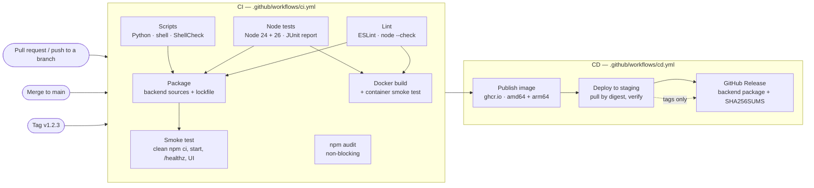

# CI/CD pipeline

Two GitHub Actions workflows build, test, package and deliver every change. They run on GitHub's hosted runners; nothing needs to be installed and no secrets need to be added (the built-in `GITHUB_TOKEN` is enough).



## When what runs

| Trigger | What runs |
|---|---|
| Push to any branch except `main` | CI |
| Pull request into `main` or `develop` | CI (required to pass before merge) |
| Merge / push to `main` | CD: the full CI suite, then image published to GHCR (`latest`, `main`, `sha-xxxxxxx`) and verified on staging |
| Push of a tag `vX.Y.Z` | CD as above (image also tagged `X.Y.Z` and `X.Y`), then a GitHub Release with the backend package |
| Manual (Actions tab → *Run workflow*) | Either workflow on any branch |

Pushes that change only Markdown or `docs/` skip CI on branches (pull requests always run it).

## CI jobs

| Job | What it checks | Blocks merge |
|---|---|---|
| **Lint** | `npm ci` from the lockfile, ESLint over `backend/`, `node --check` of every backend file | Yes |
| **Node tests** | The whole `node --test` suite on Node 24 and 26: unit, protocol, security, integration and browser-helper tests with real localhost HTTP/WebSocket/TLS listeners and in-process fakes (no real Whisper/Piper/Gemini, no paid APIs). Results appear in the run summary; JUnit XML and the log are uploaded as `node-test-report-<version>` | Yes |
| **Browser helpers** | Part of the Node test suite: `backend/tests/frontend/*.test.mjs` (capture, worklet, formatting) against the unchanged web UI | Yes |
| **Scripts** | Python files compile (`py_compile`, Python 3.10), shell scripts parse, ShellCheck finds no errors | Yes |
| **npm audit** | Known vulnerabilities in reachable dependency code | No — reported only; a finding becomes a backlog item |
| **Package** | The backend (sources, `package-lock.json`, CLIs, web UI) with README, docs and scripts as `professor-voice-assistant.tar.gz` (artifact `build-package`) | Yes |
| **Smoke test** | Unpacks the package, runs `npm ci --omit=dev`, starts the backend with a placeholder API key, waits for `/healthz`, checks the web UI is served (`scripts/ci/smoke-test.sh`) | Yes |
| **Docker** | Builds the image from `Dockerfile` and runs the same smoke test against the container | Yes |

Speech recognition, speech synthesis and Gemini are not exercised in CI: they need local models and a real API key. The real-inference checks stay manual (`node backend/bin/e2e-check.js`, `go run ./cmd/rag-eval`; see [verification](VERIFICATION.md)).

## CD jobs

1. **CI** — the CD workflow first calls the CI workflow, so nothing is published unless every check passes.
2. **Publish image** — builds `linux/amd64` and `linux/arm64` images and pushes them to `ghcr.io/<owner>/voice-assistance`.
3. **Deploy to staging and verify** — pulls the exact image just published (by digest), starts it and runs the smoke test against it.
4. **GitHub Release** (tags only) — attaches the five platform packages and `SHA256SUMS.txt`, with release notes generated from the merged pull requests.

### Making a release

```sh
git checkout main && git pull
git tag -a v1.0.0 -m "Sprint 3 increment"
git push origin v1.0.0
```

Watch it under **Actions → CD**. The release appears under **Releases** when the run is green.

### Running the image

The image contains the Node.js backend only. Whisper, Piper and the RAG sidecar keep running on the host (they need the Mac's GPU and the downloaded models), started as usual with `./scripts/start-local.sh`:

```sh
docker login ghcr.io -u <github-user>      # the package is private while the repository is
docker run --rm -p 127.0.0.1:8090:8090 \
  -e GEMINI_API_KEY=... \
  -e WHISPER_URL=http://host.docker.internal:8081 \
  -e WHISPER_MULTILINGUAL_URL=http://host.docker.internal:8082 \
  -e PIPER_EN_URL=http://host.docker.internal:5000 \
  -e PIPER_HI_URL=http://host.docker.internal:5001 \
  -e RAG_SIDECAR_URL=http://host.docker.internal:8084 \
  -v pva-data:/app/data \
  ghcr.io/<owner>/voice-assistance:latest
```

Open <http://127.0.0.1:8090>. Data (documents, professor database) lives in the `pva-data` volume.

## One-time GitHub settings

Do these once, as the repository owner, after the workflows are on `main`:

1. **Actions permissions** — *Settings → Actions → General → Workflow permissions*: keep "Read repository contents" (the workflows request `packages: write` and `contents: write` only in the jobs that need them).
2. **Branch protection** — *Settings → Branches → Add branch ruleset* (or *Add rule*) for `main`:
   - Require a pull request before merging, with 1 approval.
   - Require status checks to pass, and select: `Lint (ESLint · lockfile)`, `Node tests (24)`, `Node tests (26)`, `Scripts (Python · shell)`, `Smoke test (clean install, start, /healthz, web UI)`, `Docker image (build + smoke test)`. (They appear in the list after the first CI run.)
   - Require branches to be up to date before merging.
   Branch protection and rulesets on a **private** repository need GitHub Pro, Team or Enterprise. Students get Pro free with the GitHub Student Developer Pack; otherwise make the repository public. Without protection the pipeline still runs on every pull request — the team just has to respect a red result by agreement.
3. **Allow Actions to open pull requests** — *Settings → Actions → General → Workflow permissions*: tick "Allow GitHub Actions to create and approve pull requests" (used by the security update workflow below).
4. **Dependabot** — enabled by `.github/dependabot.yml`; its weekly pull requests go through the same pipeline.

## Security dependency updates

The **npm audit** job reports vulnerable dependencies of the backend. To fix them, run **Actions → Security dependency update → Run workflow**. With no input it runs `npm audit fix`; with `name@version` inputs it upgrades those packages. It then runs ESLint, the full test suite and `npm audit`, pushes a `deps/security-update-N` branch, opens a pull request and starts CI on it. Merge it when CI is green. Locally the same fix is:

```sh
npm audit fix --prefix backend
npm test --prefix backend
```

## Running the checks locally

```sh
npm ci --prefix backend                          # clean install from the lockfile
npm run --prefix backend lint                    # ESLint
npm test --prefix backend                        # unit, protocol, security, integration, frontend tests
bash scripts/ci/smoke-test.sh backend/src/server.js
docker build -t pva:local . && bash scripts/ci/smoke-test.sh --docker pva:local
```

## Line endings

`.gitattributes` stores every text file with LF endings. On Windows this stops editors from turning every file into a CRLF "change", and keeps the shell scripts runnable on macOS, Linux and in CI.
