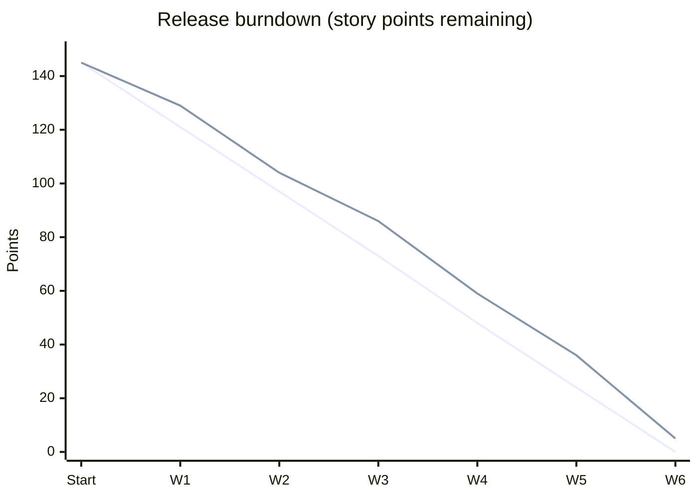

# Scrum plan — 3 sprints, 6 weeks

Professor Voice Assistant · Agile & DevOps project

This is the week-by-week plan the team follows to build the project with Scrum: three two-week sprints, each ending in a working, demonstrable increment. DevOps practices (pull requests, automated tests, CI/CD, releases) are part of the plan, not an afterthought: from Sprint 3 every increment is built, tested, packaged and deployed by the pipeline described in [CI/CD](CI_CD.md).

## At a glance

| Sprint | Weeks | Sprint goal | Committed | Completed | Release |
|---|---|---|---|---|---|
| 1 | 1–2 | A professor can talk to the assistant in English, Hindi or Hinglish and hear the answer | 46 pts | 41 pts | `v0.1.0` (git tag) |
| 2 | 3–4 | Answers grounded in the professor's own documents and the web, with citations, plus a secure desk device | 50 pts | 45 pts | `v0.2.0` (git tag) |
| 3 | 5–6 | A daily tool for the professor — timetable, reminders, notes, drafts with confirmation — delivered through an automated CI/CD pipeline | 54 pts | 54 pts | `v1.0.0` (automated GitHub Release) |

Release backlog: **145 story points** (US-01 to US-26). Done after Sprint 3: **140 points**. Remaining: US-16 (real ESP32 hardware verification, 5 pts — blocked on hardware). US-27 (Microsoft 365) is on hold and outside this release.

## Team and roles

| Role | Member | Responsibilities |
|---|---|---|
| Product Owner | [Team member 1] | Owns and orders the product backlog, writes acceptance criteria, accepts or rejects stories at the review |
| Scrum Master | [Team member 2] | Runs the events, keeps the board current, removes impediments, protects the sprint from scope changes; owns the CI/CD pipeline's health in Sprint 3 |
| Developers | [Team member 3], [Team member 4] (PO and SM also contribute code) | Turn backlog items into a done increment: backend, web UI, tests, docs |
| Stakeholder | [Faculty guide] | Attends sprint reviews and gives feedback |

## Events and cadence

Each sprint is 10 working days (Day 1 = Monday of the first week).

| Event | When | Length | Output |
|---|---|---|---|
| Sprint planning | Day 1 | 1.5 h | Sprint goal, selected stories, tasks on the board |
| Daily stand-up | Every working day (in the lab, or written in the team chat) | 15 min | Done yesterday / doing today / blockers |
| Backlog refinement | Day 4 | 45 min | Next sprint's top stories split, estimated (planning poker) and given acceptance criteria |
| Sprint review | Day 10 | 1 h, with the guide | Live demo of the increment; backlog updated |
| Sprint retrospective | Day 10, after the review | 30–45 min | 1–3 concrete improvement actions for the next sprint |

## Working agreements (DevOps)

- **Branches.** `main` is always releasable and protected. Work happens on `feature/US-xx-short-name` branches; one story (or a slice of one) per pull request.
- **Pull requests.** Every change reaches `main` through a pull request using the repository template, reviewed by at least one other member. From Sprint 3 the CI pipeline must be green before merge.
- **Board.** GitHub Projects board with columns *Product Backlog → Sprint Backlog → In Progress → In Review (PR open, CI running) → Done*. Each story is a GitHub issue (template "User story"); each sprint is a milestone. `bash scripts/scrum/setup-github.sh` creates the labels, milestones and backlog issues.
- **Estimation.** Planning poker, Fibonacci points (1, 2, 3, 5, 8). Anything larger than 8 is split before it enters a sprint.

### Definition of Ready (a story may enter a sprint when…)

- It is written as *As a…, I want…, so that…* with testable acceptance criteria.
- It is estimated at 8 points or less.
- Its dependencies (hardware, API keys, other stories) are available or explicitly planned.

### Definition of Done

- Acceptance criteria met and demonstrated in the running application (or the device simulator for device stories).
- Merged to `main` through a reviewed pull request.
- `go vet` is clean; Go tests pass with the race detector; JavaScript tests pass.
- **From Sprint 3:** the CI pipeline is green on the pull request, and the increment shown at the review is the build the CD pipeline produced.
- Privacy and confirmation rules respected; README, `docs/` and `.env.example` updated; no open critical defect.

---

## Sprint 1 — Weeks 1–2: bilingual voice loop

**Sprint goal:** a professor holds a button, asks a question in English, Hindi or Hinglish, and hears the answer — with speech recognised on the professor's own computer.

**Sprint backlog (committed 46 points)**

| ID | Story | Pts | Result |
|---|---|---|---|
| US-01 | Hold a button and ask a question by voice in the browser | 8 | Done |
| US-02 | Speech transcribed on my own computer (whisper.cpp) | 5 | Done |
| US-03 | Answer streamed and spoken sentence by sentence | 8 | Done |
| US-04 | Type a question and read the answer | 3 | Done |
| US-05 | Stop a reply at any time | 3 | Done |
| US-06 | Answers in a Hindi voice when I ask in Hindi | 3 | Done |
| US-07 | Ask in Hindi or Hinglish and be understood | 8 | Done |
| US-08 | Measure speech-recognition accuracy (WER/CER) on public recordings | 5 | Carried over to Sprint 2 |
| US-23 | One command to start and stop everything, plus a configuration check | 3 | Done |

### Week 1

| Day | Activity |
|---|---|
| Mon (Day 1) | Project kick-off; Product Owner presents the product vision and initial backlog. **Sprint 1 planning**: goal, stories, tasks. Create GitHub repository, branch protection on `main`, PR and issue templates, `.gitattributes` |
| Tue–Wed | Go HTTP server with `/healthz` and `/readyz`; WebSocket protocol (JSON control + binary audio frames); AudioWorklet microphone capture and PCM16 streaming |
| Thu (Day 4) | Resampling to 16 kHz and speech/silence validation in Go; whisper.cpp client. **Backlog refinement** for Sprint 1 leftovers |
| Fri | Gemini streaming client; text chat path; first end-to-end English demo inside the team |

*End of week 1 — done: US-01, US-02, US-04 (16 pts). Remaining release backlog: 129 pts.*

### Week 2

| Day | Activity |
|---|---|
| Mon–Tue | Sentence splitter and Piper text-to-speech queue; stop/cancel handling with turn IDs (US-03, US-05) |
| Wed | Language routing: English → Whisper small, Hindi/Hinglish/Auto → large-v3-turbo; Hindi Piper voice (US-06, US-07) |
| Thu | `setup-local.sh`, `start-local.sh`, `stop-local.sh` and `config-check` (US-23); unit tests for framing, PCM, resampling, sentence splitting. Start STT evaluation tooling (US-08) |
| Fri (Day 10) | **Sprint review**: live demo in English and Hindi to the guide. **Retrospective**. Tag `v0.1.0` |

*End of week 2 — done: US-03, US-05, US-06, US-07, US-23 (25 pts). Remaining: 104 pts. US-08 not finished → carried over.*

**Retrospective actions**

- Manual audio testing is slow → finish the automated STT evaluation (US-08) first thing in Sprint 2.
- US-07 depended on unfinished routing work → split stories that depend on unfinished work at refinement.
- Merges needed more coordination → one story per pull request, with a short description using the template.

---

## Sprint 2 — Weeks 3–4: grounded answers and secure desk device

**Sprint goal:** answers grounded in the professor's own documents and in web search, with verifiable citations and privacy control; an ESP32 desk device can join securely.

**Sprint backlog (committed 50 points)**

| ID | Story | Pts | Result |
|---|---|---|---|
| US-08 | Measure STT accuracy (carried over) | 5 | Done |
| US-09 | Desk device (ESP32) that connects securely to my computer | 8 | Done |
| US-10 | Device simulator | 5 | Done |
| US-11 | Upload course documents (PDF, DOCX, PPTX, TXT, MD), indexed locally | 8 | Done |
| US-12 | Answers grounded in my documents with citations | 8 | Done |
| US-13 | Current information from a web search with sources | 5 | Done |
| US-14 | Decide whether document text may be sent to the cloud model | 3 | Done |
| US-15 | Evaluate retrieval quality (Recall@k, MRR) | 3 | Done |
| US-16 | Verify the desk device on real ESP32 hardware | 5 | Not done — hardware unavailable; back to backlog |

### Week 3

| Day | Activity |
|---|---|
| Mon (Day 1) | **Sprint 2 planning**. Finish STT evaluation on FLEURS / OpenSLR recordings; fix the speech gate that rejected quiet speech (English WER 62.4 % → 6.7 %) (US-08) |
| Tue–Wed | Document upload, validation and text extraction (TXT, MD, DOCX, PPTX in Go; PDF in the Python sidecar); chunking by headings and pages (US-11) |
| Thu (Day 4) | Device protocol design: TLS listener, per-device HMAC challenge–response, paced 16 kHz audio. **Backlog refinement** for Sprint 3 (professor tools) |
| Fri | `device-sim` simulator and `devicectl` provisioning (US-10); SQLite FTS5 keyword index |

*End of week 3 — done: US-08, US-10, US-11 (18 pts). Remaining: 86 pts.*

### Week 4

| Day | Activity |
|---|---|
| Mon–Tue | Multilingual-e5 embeddings, hybrid search with Reciprocal Rank Fusion, citation checking and injection-safe evidence (US-12); device gateway finished and tested with the simulator (US-09) |
| Wed | Tavily web search with caching (US-13); consent setting for sending passages to Gemini (US-14) |
| Thu | `rag-eval` tool: Recall@5 = 100 % on the labelled set (US-15). Attempt real ESP32 test (US-16) — blocked: hardware not available |
| Fri (Day 10) | **Sprint review**: document Q&A with citations, web search, device via simulator. **Retrospective**. Tag `v0.2.0` |

*End of week 4 — done: US-09, US-12, US-13, US-14, US-15 (27 pts). Remaining: 59 pts.*

**Retrospective actions**

- Tests are run by hand before each review and were once forgotten → **automate build, test and delivery (US-26) at the start of Sprint 3**, and make a green pipeline part of the Definition of Done.
- Hardware availability blocked US-16 → track it as its own story; do not commit it again until hardware is confirmed.
- Some stories mixed backend and UI work → separate UI tasks on the board.

---

## Sprint 3 — Weeks 5–6: professor's daily tool, delivered by CI/CD

**Sprint goal:** turn the assistant into a professor's daily tool — timetable, reminders, notes, memos and drafts, with confirmation before any change — and deliver every increment through an automated CI/CD pipeline.

**Sprint backlog (committed 54 points)**

| ID | Story | Pts | Result |
|---|---|---|---|
| US-26 | Every push automatically built and tested; every merge to `main` published and deployed (CI/CD) | 8 | Done |
| US-17 | Weekly timetable with today's and the next class | 8 | Done |
| US-18 | Create reminders by voice and be notified when due | 8 | Done |
| US-19 | Notes and voice memos searchable in English or Hindi | 5 | Done |
| US-20 | Email and announcement drafts that are never sent automatically | 5 | Done |
| US-21 | Confirm or cancel every data-changing action by voice or button | 8 | Done |
| US-22 | Clean, responsive web interface with a dashboard | 5 | Done |
| US-24 | Optional read-only Google Calendar and Gmail drafts | 5 | Done |
| US-25 | Realistic demo data | 2 | Done |

### Week 5

| Day | Activity |
|---|---|
| Mon (Day 1) | **Sprint 3 planning**. Scrum Master starts US-26: GitHub Actions **CI** workflow — gofmt, `go vet`, Go tests with race detector, web tests, script checks, cross-platform build, smoke test. Turn on branch protection: CI must pass before merge |
| Tue | SQLite professor database with migrations (classes, reminders, notes, memos, drafts); timetable API and views (US-17) |
| Wed | Reminder scheduler, recurrence and browser notifications (US-18); `Dockerfile` and container smoke test (US-26) |
| Thu (Day 4) | Draft editor — copy only, never send (US-20); demo seed data (US-25). **Backlog refinement**: what remains after the release |
| Fri | **CD** workflow: on merge to `main`, publish the Docker image to GitHub Container Registry and verify the deployed image; on a version tag, create a GitHub Release with binaries and checksums. Dependabot enabled (US-26 continues) |

*End of week 5 — done: US-17, US-18, US-20, US-25 (23 pts). Remaining: 36 pts. From now on every pull request runs the pipeline.*

### Week 6

| Day | Activity |
|---|---|
| Mon | Tool calling with staged proposals and voice/button confirmation, executed at most once (US-21) |
| Tue | Notes and memo transcripts indexed for English/Hindi search (US-19); optional Google Calendar and Gmail drafts behind feature flags (US-24) |
| Wed | Redesigned responsive interface: sidebar, dashboard, ten screens (US-22); browser UI checks |
| Thu | Hardening: fix defects found by CI, update README, `docs/`, `.env.example`; first full CD run on `main` — image published and verified (US-26 done) |
| Fri (Day 10) | Tag **`v1.0.0`** → pipeline builds the GitHub Release. **Sprint review** starts from the latest green pipeline run and demos the released build. **Retrospective** |

*End of week 6 — done: US-19, US-21, US-22, US-24, US-26 (31 pts). Remaining: 5 pts (US-16).*

**Retrospective actions**

- The pipeline caught problems before review instead of after → keep the green pipeline as a merge requirement.
- The sprint was large (54 pts) → keep future commitments near the measured average velocity (~47 pts).
- Track US-16 (real hardware) and US-27 (Microsoft 365) as the first items of the next release.

---

## Velocity

| Sprint | Committed | Completed | Completion |
|---|---|---|---|
| Sprint 1 | 46 | 41 | 89 % |
| Sprint 2 | 50 | 45 | 90 % |
| Sprint 3 | 54 | 54 | 100 % |
| **Average velocity** | | **46.7** | |

Velocity rose in Sprint 3 because the architecture and test harness from earlier sprints made features cheaper, and the CI pipeline removed the manual test pass before each review.

## Release burndown (story points remaining at the end of each week)

| | Start | Week 1 | Week 2 | Week 3 | Week 4 | Week 5 | Week 6 |
|---|---|---|---|---|---|---|---|
| Ideal | 145 | 121 | 97 | 73 | 48 | 24 | 0 |
| Actual | 145 | 129 | 104 | 86 | 59 | 36 | 5 |

The 5 points left at the end are US-16 (verification on real ESP32 hardware), blocked on hardware availability.

## How CI/CD fits into each Scrum event

| Scrum event | CI/CD touch-point |
|---|---|
| Sprint planning | DevOps tasks (pipeline, Dockerfile, dependency updates) are planned as backlog items like any other work |
| Daily stand-up | A red pipeline on `main` is the first blocker discussed |
| Pull request / review | CI must be green; the PR template carries the Definition of Done checklist |
| Sprint review | Demo starts from the latest green CD run: the published image or the GitHub Release for the sprint's tag |
| Retrospective | Pipeline duration, failures and flaky tests are reviewed; fixes become backlog items |
